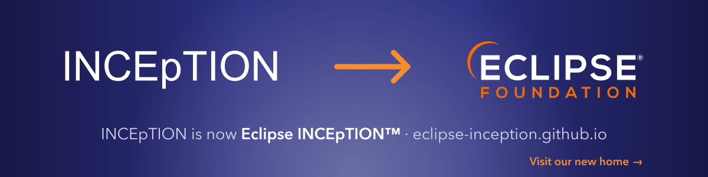

<a href="https://eclipse-inception.github.io/">
<picture>
  <source media="(hover: hover) and (pointer: fine)" srcset="https://github.com/inception-project/.github/raw/main/profile/moved-banner-click.svg">
  <source media="(hover: none) and (pointer: coarse)" srcset="https://github.com/inception-project/.github/raw/main/profile/moved-banner-tap.svg">
  
</picture>
</a>

## We have moved

INCEpTION is now an incubating project at the [Eclipse Foundation](https://www.eclipse.org) under
the name **Eclipse INCEpTION™**. Its website, downloads, documentation, source code and issue
tracker have moved:

- **Website:** [eclipse-inception.github.io](https://eclipse-inception.github.io/)
- **Source code and issue tracker:** [eclipse-inception/inception](https://github.com/eclipse-inception/inception)
- **Project page at Eclipse:** [technology.inception](https://projects.eclipse.org/projects/technology.inception)

Old links keep working: links to the old website take you to the same page on the new one, and
links to the old repository take you to the new one.

### Related tools and extensions

This organisation stays on as a home for projects around Eclipse INCEpTION™. They are not part of
the Eclipse INCEpTION™ project and are maintained separately.

**Tools**

- [pycaprio](https://github.com/inception-project/pycaprio): Python client for INCEpTION
- [External recommender](https://github.com/inception-project/inception-external-recommender):
  get annotation suggestions from spaCy, Sentence BERT, scikit-learn and more through a web service
- [Reporting dashboard](https://github.com/inception-project/inception-reporting-dashboard): plots
  that show the progress of your INCEpTION project
- [Helm chart](https://github.com/inception-project/inception-helm-chart): deploy INCEpTION on
  Kubernetes
- [LegalDocML format](https://github.com/inception-project/inception-legaldocml-format): annotate
  OASIS LegalDocML / Akoma Ntoso documents

**Elsewhere**

- [INCEpTALYTICS](https://github.com/ltl-ude/inceptalytics): analyze INCEpTION annotation projects,
  with project statistics, inter-annotator agreement and progress reports

**Examples and experiments**

These are starting points for your own work. They may not work with the current version of
INCEpTION.

- [Lookup service examples](https://github.com/inception-project/inception-lookup-service-example):
  Python lookup services for Wikidata and the EMBL-EBI Ontology Lookup Service
- [Command line tool](https://github.com/inception-project/inception-cli): import, export and
  delete from the command line
- Editor plugins that integrate other annotation editors:
  [Apache Annotator](https://github.com/inception-project/inception-apache-annotator-editor-plugin),
  [AnnotatorJS](https://github.com/inception-project/inception-annotatorjs-editor-plugin),
  [Doccano](https://github.com/inception-project/inception-doccano-sequence-editor-plugin),
  [Intertext](https://github.com/inception-project/inception-intertext-editor-plugin),
  [Recogito](https://github.com/inception-project/inception-recogito-editor-plugin)

Working on something that belongs here?
[Suggest it for this list](https://github.com/inception-project/inception-project.github.io/issues).

---

Eclipse INCEpTION, INCEpTION, Eclipse, and the Eclipse logo are trademarks of Eclipse Foundation
AISBL.
